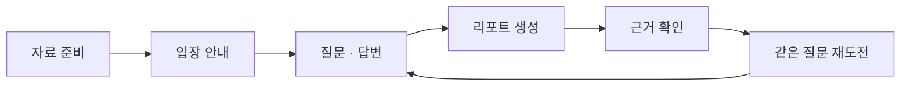
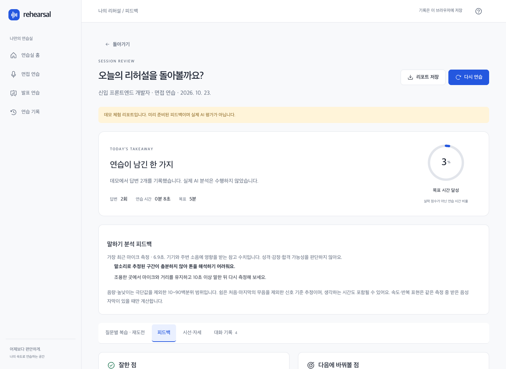
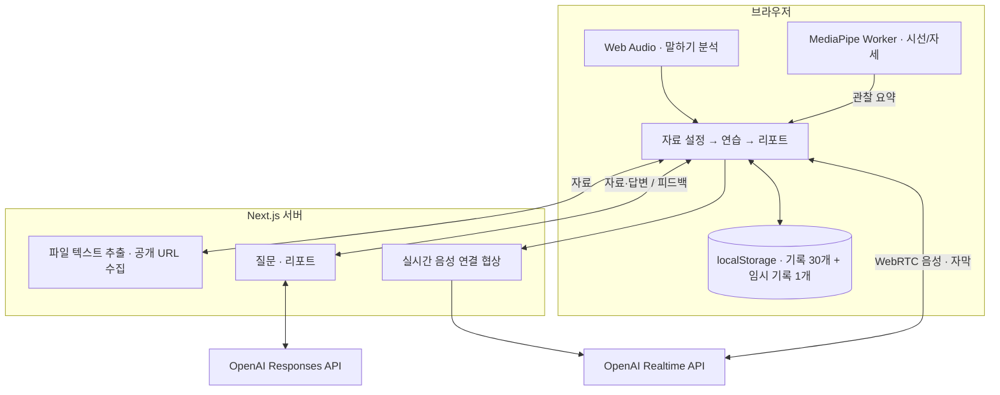

<div align="center">

# Rehearsal · 리허설

### 중요한 순간 전, 한 번 더 리허설.

**내 자료로 질문받고, 직접 답하고, 근거가 있는 피드백으로 다시 연습합니다.**

자기소개서 기반 AI 면접 · 발표 중 반박 질문 · 말하기와 시선·자세 코칭


[체험 순서](#try) · [주요 기능](#features) · [화면](#screens) · [실행 방법](#setup) · [구조](#architecture) · [검증](#verification)

</div>


리허설은 교내 ICT 경진대회를 위해 개발하는 **한국어 AI 연습실**입니다. 면접에서는 경험과 채용공고를 연결하는 질문을, 발표에서는 주장과 근거를 확인하는 반박 질문을 받습니다. 연습을 마치면 답변 내용·말하기·선택형 카메라 관찰을 리포트로 확인하고, 부족했던 답변을 같은 질문으로 다시 연습합니다.

현재는 **로컬 단일 사용자용**입니다. 공개 저장소이며, 별도의 공개 서비스는 제공하지 않습니다.

<a id="try"></a>
## 먼저 체험해 보기

> [!TIP]
> **API 키 없이 데모를 사용할 수 있습니다.** 아래 실행 방법으로 앱을 켠 뒤, 예시 자료로 전체 흐름을 체험하세요. 데모는 미리 준비한 질문과 피드백이며 실제 AI 평가가 아닙니다.

1. 홈에서 **면접 연습** 또는 **발표 연습**을 선택합니다.
2. **예시 불러오기 → 데모 체험 → 데모 연습 시작**을 누릅니다.
3. 입장 안내에서 진행 순서를 확인합니다. 카메라는 선택 사항입니다.
4. **첫 질문 받기**를 누르고 답변을 작성·제출합니다.
5. 상단의 **연습 종료 · 리포트 생성**으로 결과를 확인합니다.
6. **리포트 저장**으로 내려받거나, 질문별 복습에서 같은 질문에 다시 답합니다.



실제 AI를 사용하려면 OpenAI API 키를 설정하고 OpenAI 모드를 선택합니다. 텍스트 답변과 **실시간 음성 연결**을 지원하며, 음성 대화에는 한국어 자막을 제공합니다.

<a id="features"></a>
## 두 가지 연습, 하나의 복습 흐름

| | 면접 연습 | 발표 연습 |
| :--- | :--- | :--- |
| 준비 자료 | 이력서·자기소개서 + 선택형 채용공고·기업 정보·인재상 | 발표 원고·슬라이드 텍스트 |
| 질문 방향 | 경험, 본인 기여, 지원 직무의 요구 역량 | 문제 정의, 차별점, 주장의 근거와 한계 |
| 진행 방식 | 답변에 따른 다음 질문과 꼬리 질문 | 발표 중 주장 탐지 후 반박 질문 또는 수동 질문 요청 |
| 복습 | 질문별 피드백, 공고 요구 역량 확인, 답변 재도전 | 반박의 근거가 된 발언 확인, 답변 재도전 |

### 01 · 내 자료에서 출발하는 질문

- **파일 또는 텍스트 입력**: TXT·PDF·DOCX·PPTX에서 텍스트를 추출합니다.
- **기업 자료 가져오기**: 채용공고·기업 정보·가치관 URL을 수집하고, 내용을 확인·수정합니다. 실패하면 **수동 입력** 버튼으로 원문을 붙여 넣습니다.
- **출처 확인**: 텍스트 질문의 **질문에 사용한 자료**에서 원문 인용을 확인합니다. 입력 자료에 실제로 존재하는 인용만 남깁니다.

음성 모드에도 준비 자료를 전달합니다. 참고 근거를 말로 밝히도록 지시하며, 텍스트 모드와 같은 별도 출처 카드는 제공하지 않습니다.

### 02 · 답변하는 동안 선택해서 쓰는 코칭

| 도구 | 제공하는 정보 | 사용 방법 |
| :--- | :--- | :--- |
| 말하기 분석 | 음량·음높이 변화, 쉼, 소리 찌그러짐 가능성 | **말하기 분석 시작** 또는 실시간 음성 연결 |
| 자막 분석 | 글자/분, “음·어·저기·그러니까” 반복 | 실제 사용자 음성 자막이 있을 때 계산 |
| 시선·자세 코칭 | 기준 자세에서 벗어난 구간, 눈 방향 추정, 어깨·손목 관찰 | 카메라 켜기 → **10초 기준 자세 보정** |
| 답변 힌트 | 경험 → 본인 행동 → 결과를 떠올리는 3단계 안내 | 연습 방식 **코칭**에서 사용, **실전**에서는 숨김 |

카메라는 음성 모드의 사용자 발화 구간, 또는 텍스트 모드에서 직접 시작·종료한 답변 구간을 측정합니다. AI 발화·일시정지·백그라운드 탭은 제외합니다. 입장 안내에서 자료 참조 여부와 관찰 피드백 시점을 선택할 수 있습니다.

> [!NOTE]
> 카메라 코칭은 연습을 위한 관찰입니다. 눈 방향 추정은 실험 기능이며, **글 읽기·부정행위·감정·성격·채용 적합성을 판정하지 않습니다.** 원본 영상은 저장하지 않습니다.

### 03 · 리포트에서 다음 연습까지

| 결과 | 확인하거나 할 수 있는 일 |
| :--- | :--- |
| 답변 피드백 | 잘한 점, 개선점, 실제 발언 인용, 다음 연습 과제 |
| 질문별 복습 | 질문·답변·피드백과 해당 답변의 말하기·카메라 관찰 확인 |
| 같은 질문 재도전 | 고정된 평가 기준으로 이전·이번 답변의 근거 비교 |
| 공고 요구 역량 | 공고 원문과 답변 인용 연결, 미확인 역량 집중 연습 |
| 저장·내보내기 | 최근 30개 기록 다시 열기, Markdown 리포트 다운로드 |
| 중단 복구 | 현재 브라우저의 임시 기록 1개에서 자료·대화·입력 중 답변 이어가기 |

공고 요구 역량은 **근거 확인 / 추가 설명 필요 / 이번 답변에서 미확인**으로 표시합니다. 능력 부족이나 채용 적합성 점수가 아닙니다. 데모의 재도전은 원문 비교만 제공하며 AI가 개선 여부를 평가하지 않습니다.

리포트 생성에 실패해도 대화를 유지하고 재시도할 수 있습니다. 실제 AI 오류를 데모 결과로 바꾸지 않습니다.

<a id="screens"></a>
## 연습에 집중하는 화면

밝은 작업 공간과 공통 버튼·패널 체계를 사용합니다. 홈에서는 **면접은 파랑, 발표는 초록**으로 구분하고, 연습방에서는 대화와 답변 입력을 중심에 둡니다.


- **입장 전 안내**에서 선택 항목과 진행 순서를 확인합니다.
- 연습방 오른쪽의 **코칭 도구 / 참고 자료**로 필요한 내용을 전환합니다. 자료를 보더라도 이미 시작한 측정은 유지됩니다.
- 종료 버튼을 상단에 두어 **리포트를 만드는 다음 행동**이 보이게 합니다.
- 임시 기록 복원 알림은 잠시 후 부드럽게 접힙니다. 이어가기 카드의 **×**는 카드만 숨기며, 기록 삭제는 별도 버튼으로 처리합니다.
- 첫 홈 진입과 메뉴 전환에 짧은 모션을 적용합니다. 주요 카드가 사라질 때 아래 요소도 이어서 이동하며, 운영체제의 **모션 감소** 설정을 따릅니다.
- 확인 모달은 키보드 포커스를 관리하고 Escape로 취소할 수 있습니다.

<details>
<summary><strong>입장 전 안내 보기</strong></summary>


</details>

<details>
<summary><strong>완성된 리포트 보기</strong></summary>



</details>

화면 이미지는 가상 자료로 진행한 데모입니다. 실제 OpenAI의 평가 결과를 나타내지 않습니다.

<a id="setup"></a>
## 로컬 실행

**Node.js 22 이상 · pnpm · 브라우저**가 필요합니다.

```sh
git clone https://github.com/luckyandy7/rehearsal-studio.git
cd rehearsal-studio
pnpm install --frozen-lockfile
cp .env.example .env.local
pnpm dev
```

[http://127.0.0.1:3000](http://127.0.0.1:3000)을 엽니다. 포트가 사용 중이면 터미널에 표시된 주소를 확인하세요.

첫 실행에는 카메라 모델 다운로드를 위한 네트워크가 필요합니다. 개발·빌드 명령이 모델과 WASM을 준비하고 SHA-256을 확인합니다. 이후 검증된 로컬 캐시를 재사용합니다. 수동 준비 명령은 `pnpm camera:prepare`입니다.

### 실제 OpenAI 연결

루트의 **`.env.local`**에 키를 넣고 서버를 다시 시작합니다. 기본값은 [.env.example](.env.example)에서 확인할 수 있습니다.

| 환경 변수 | 역할 | 코드 기본값 |
| :--- | :--- | :--- |
| `OPENAI_API_KEY` | 서버 전용 API 키 | 없음 — 데모 사용 가능 |
| `OPENAI_MODEL` | 질문 생성 | `gpt-6-luna` |
| `OPENAI_REPORT_MODEL` | 리포트 생성 | `gpt-6.1-sol` |
| `OPENAI_REALTIME_MODEL` | 실시간 음성 | `gpt-realtime-2.1-mini` |
| `NEXT_PUBLIC_ENABLE_REACT_DEVTOOLS` | 개발용 React Grab·Scan | `0` |

`.env.local`은 Git에서 제외합니다. 비밀 키에 `NEXT_PUBLIC_` 접두사를 붙이지 마세요. 실제 AI 모드는 OpenAI API 사용 요금이 발생합니다.

프로덕션 실행:

```sh
pnpm build
pnpm start
```

개발·빌드는 Webpack을 사용하고, 서버는 기본적으로 `127.0.0.1`에 바인딩됩니다. 공개 서비스 배포 전에는 사용자 인증과 사용자별 사용량·과금 제한이 필요합니다.

<a id="architecture"></a>
## 시스템 구조

**하나의 Next.js 앱**이 UI와 서버 API를 제공합니다. 마이크 신호와 카메라 영상 분석은 브라우저에서 처리하고, AI 요청에 사용하는 비밀 키는 서버에 둡니다.



| 영역 | 기술 |
| :--- | :--- |
| 앱·타입 | Next.js 16, React 19, TypeScript strict |
| UI | Tailwind CSS 4, CSS 토큰, Motion, Radix UI, Phosphor Icons |
| AI·통신 | OpenAI SDK, WebRTC, ky, Zod |
| 카메라 | MediaPipe Tasks Vision, Web Worker, WASM |
| 말하기 | Web Audio API, 로컬 신호 분석 |
| 자료 처리 | Cheerio, ipaddr.js, pdf-parse, mammoth, fflate |
| 품질 확인 | Biome, Playwright, Node 회귀 검사 |

<details>
<summary><strong>주요 코드 위치</strong></summary>

```text
src/
├── app/api/              질문·리포트·음성·문서·URL API
├── components/
│   ├── studio-app.tsx    화면 전환·기록
│   ├── setup.tsx         자료·연습 설정
│   ├── session-guide.tsx 입장 안내·카메라 준비
│   ├── session.tsx       연습 진행·리포트 생성
│   ├── report.tsx        결과·복습
│   └── camera-*.tsx      카메라 준비·측정·피드백
├── hooks/               음성·마이크·카메라·모션
├── lib/                 분석·검증·저장·서버 로직
└── workers/             MediaPipe 영상 처리
scripts/                 모델 다운로드·무결성 확인
tests/                   분석·API·브라우저 회귀 검사
docs/                    설계·검증·화면 이미지
```

</details>

## 데이터 처리와 기능 범위

| 데이터 | 어디서 처리하나요? |
| :--- | :--- |
| 이력서·기업 자료·답변 | 실제 AI 모드에서 OpenAI 전송. 기록은 현재 브라우저에 저장 |
| 실시간 음성 | 대화를 위해 OpenAI로 전송 |
| 독립 말하기 분석 | 브라우저에서 계산. 수치·피드백 저장 및 AI 리포트에 전달 |
| 카메라 영상·프레임·좌표 | 기기 안에서 처리. 서버 전송·영구 저장 없음 |
| 카메라 관찰 요약 | 브라우저 저장. **OpenAI 리포트에도 사용하기**를 선택한 경우에만 전송 |
| 업로드 파일 | 서버에서 텍스트 추출. 원본 별도 디스크 저장 없음 |
| URL | 서버가 공개 페이지를 방문해 본문과 출처 추출 |

원본 영상·오디오를 녹화 파일로 보관하지 않습니다. 카메라 타임라인은 입장 이후 관찰 구간이며 영상 재생 기능은 아닙니다. 브라우저 데이터를 지우면 기록도 사라지므로 필요한 리포트는 내려받으세요.

<details>
<summary><strong>입력 한도와 지원하지 않는 자료</strong></summary>

| 항목 | 한도 |
| :--- | :--- |
| 업로드 | 파일당 10 MiB, PDF 80쪽 이하 |
| 연습 자료 텍스트 | 30,000자 |
| 채용공고 / 기업 정보 / 가치관 | 8,000 / 4,000 / 4,000자 |
| URL 수집 | 공개 HTML·텍스트, 12초·2 MB·리다이렉트 3회 |
| 카메라 기록 | 답변 측정 최대 30분, 관찰 구간 최대 80개 |

스캔 문서 OCR, 슬라이드 이미지 이해, 로그인·봇 차단·자바스크립트 전용 페이지 수집은 지원하지 않습니다. URL 수집은 내부 네트워크 주소를 차단합니다. 가져온 본문은 직접 검토한 뒤 사용하세요.

</details>

<details>
<summary><strong>발표 자동 반박과 음성 복구의 범위</strong></summary>

- 확정 자막에서 성능·수요·안전·차별성 표현을 찾는 규칙 기반 탐지입니다. 모든 논리적 허점을 이해하는 기능은 아닙니다.
- 발화 종료 후 최소 1.2초를 기다립니다. 질문 간 최소 간격은 부드럽게 75초, 보통 45초, 압박 25초입니다.
- 사용자 발화·AI 응답·일시정지 중에는 자동 질문하지 않습니다. 같은 발언을 반복 질문하지 않으며, **지금 반박 질문 받기**로 직접 요청할 수도 있습니다.
- 음성 오류 시 텍스트로 계속하거나 다시 연결할 수 있습니다. 재연결에는 확정된 대화를 전달합니다.
- 새로고침 후 임시 기록으로 이어갈 수 있지만 마이크·카메라는 다시 연결·보정해야 합니다. 미확정 자막과 원본 오디오는 복구하지 않습니다.

</details>

<a id="verification"></a>
## 검증 상태

자동 검사는 **앱의 연결과 동작**을 확인하며, 실제 사람의 시선 정확도나 면접 평가의 타당성을 증명하지 않습니다. 날짜별 증거와 미검증 범위는 [QA 기록](docs/QA.md)에 정리합니다.

| 범위 | 확인한 내용 |
| :--- | :--- |
| 최신 UI | 홈 색상 구분, 연습방 도구 전환, 입장·확인 모달, 반응형 화면 |
| 데모 전체 흐름 | URL 실패 후 수동 입력, 면접·발표, 리포트·다운로드·기록 복원 |
| 복습·복구 | 리포트 재시도, 같은 질문 재도전, 역량 연습, 힌트, 임시 기록 |
| 카메라 통합 | 가상 장치·모델 결과로 권한·보정·공유 동의·자원 해제 검사 |
| 실제 MediaPipe | 2026-10-21 공식 샘플 영상으로 Worker·모델 실행 |
| 실제 OpenAI | 2026-10-22 질문·리포트 생성, 실제 WebRTC 응답·한국어 자막·오디오 수신 |

실제 사람의 다회차 음성 면접·발표, 다양한 안경·조명 조건의 시선 오탐률, Safari·Firefox·저성능 모바일은 추가 현장 검증이 필요합니다.

<details>
<summary><strong>검사 실행 방법</strong></summary>

```sh
pnpm typecheck
pnpm lint
pnpm build
node tests/camera-analysis.cjs
node tests/camera-report-api.cjs
node tests/learning-analysis.cjs
```

서버를 실행한 뒤 별도 터미널에서 통합 검사를 실행합니다.

```sh
pnpm start --port 3001
```

```sh
node tests/core-regression.cjs
node tests/studio-browser.cjs
node tests/camera-browser.cjs
node tests/camera-realtime.cjs
node tests/camera-failures.cjs
node tests/learning-browser.cjs
node tests/learning-realtime.cjs
node tests/ui-interactions.cjs
```

기본 검사 주소는 `http://127.0.0.1:3001`이며 `TEST_BASE_URL`로 변경합니다. 브라우저 검사는 설치된 Google Chrome을 사용하고 공개 URL 검사는 네트워크 연결이 필요합니다.

위 회귀 검사는 OpenAI 유료 호출을 하지 않습니다. 카메라 브라우저 검사는 모델 결과를, RTC 검사는 서버 이벤트를 대체합니다. 실제 서비스 검증과 구분해야 합니다.

</details>

## 문제 해결

| 상황 | 확인할 것 |
| :--- | :--- |
| AI 키 미설정 | 루트 `.env.local` 설정 후 서버 재시작 |
| API 한도·잔액 오류 | 해당 키 조직의 [API 결제 상태](https://platform.openai.com/settings/organization/billing) 확인 |
| URL 수집 실패 | **수동 입력**으로 필요한 원문 붙여 넣기 |
| 리포트 버튼 비활성화 | 답변을 남겼는지, **나의 답변** 자막이 확정됐는지 확인 |
| 마이크·카메라 연결 실패 | 사이트 권한, HTTPS/localhost, 다른 앱의 장치 사용 확인 |
| 카메라 보정 실패 | 얼굴 전체와 조명 확인 후 재보정 또는 **카메라 없이 진행** |
| 말하기 측정 부족 | 조용한 곳에서 일정한 마이크 거리로 10초 이상 말하기 |
| 카메라 모델 준비 실패 | 네트워크 확인 후 `pnpm camera:prepare` |

## 개발 문서

| 문서 | 내용 |
| :--- | :--- |
| [DESIGN.md](DESIGN.md) | 색상·타이포·간격·접근성·모션 |
| [QA 기록](docs/QA.md) | 날짜별 검사 결과와 남은 검증 |
| [구현 현황](docs/IMPLEMENTATION-PLAN.md) | 기능별 구현·검증 범위 |
| [오픈소스 고지](THIRD-PARTY.md) | 라이선스와 참고 구현 |
| [서버 참고 자료](src/lib/server/SOURCES.md) | API·문서 처리 출처 |
| [디자인 도구](docs/DESIGN-TOOLS.md) · [개발 스킬](docs/SKILL-SOURCES.md) | 개발에 참고한 도구와 역할 |

Google Stitch는 사용하지 않습니다. 외부 도구 원본·로컬 개발 스킬은 저장소에 포함하지 않고 [출처·해시 목록](.design-tools/sources.lock.json)을 유지합니다.
