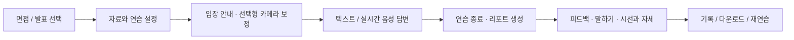
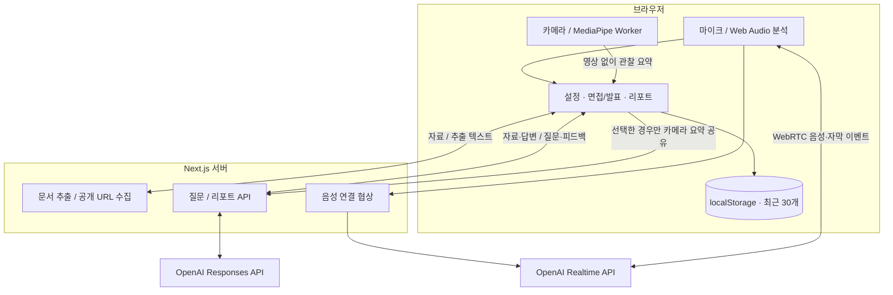

<div align="center">

# Rehearsal · 리허설

### 중요한 순간 전, 한 번 더 리허설.

자기소개서로 면접을 준비하고, 발표 자료로 반박 질문에 답하는 **한국어 AI 연습실**.


[기능 소개](#features) · [화면 보기](#screens) · [사용 순서](#workflow) · [설치와 실행](#setup) · [시스템 구조](#architecture) · [검증과 한계](#verification)

</div>


리허설은 교내 ICT 경진대회를 위해 만드는 프로젝트입니다. 자료에 근거한 질문에 직접 답하고, **답변 내용·말하기·시선과 자세**를 하나의 리포트에서 돌아봅니다. 현재 버전은 로컬 단일 사용자 연습용이며, 공개 저장소가 곧 공개 서비스 배포를 의미하지는 않습니다.

> [!TIP]
> API 키 없이 체험하려면 **면접 또는 발표 → 예시 불러오기 → 데모 체험**을 선택하세요. 실제 AI와 실시간 음성은 서버의 OpenAI API 키가 필요합니다.

<a id="features"></a>
## 어떤 연습을 할 수 있나요?

면접과 발표는 별도의 진행 화면을 사용하고, 자료 준비·코칭·리포트·기록을 공유합니다.

화면은 밝은 작업 공간과 공통 버튼·패널 체계로 구성합니다. 연습방은 대화를 중심으로 배치하고, 오른쪽 **코칭 도구 / 참고 자료** 버튼으로 마이크·카메라와 준비 자료를 전환합니다. 자료를 보는 동안에도 이미 시작한 측정은 유지됩니다. 힌트와 연습 안내는 아래에서 계속 확인할 수 있습니다.

| | 면접 연습 | 발표 연습 |
| :--- | :--- | :--- |
| 준비 | 이력서·자기소개서, 선택적으로 채용공고·기업 정보 | 발표 원고·슬라이드 텍스트 |
| 질문 | 경험, 본인 기여, 요구 역량을 연결하는 꼬리 질문 | 문제 정의, 차별점, 근거·한계를 묻는 반박 질문 |
| 음성 진행 | 답변이 끝나면 다음 질문, 한 질문 재도전도 지원 | 확정 자막의 주장을 찾아 쉼 뒤 반박, 수동 질문도 가능 |
| 결과 | 실제 발언 근거와 개선점, 다음 연습 과제 | 실제 발언 근거와 개선점, 다음 연습 과제 |

### 자료에 근거한 질문

채용공고·기업 정보·가치관을 **URL 가져오기**로 수집하고 내용을 확인·수정합니다. 수집이 안 되면 **수동 입력**을 눌러 원문을 붙여 넣습니다. 실패해도 기존 내용은 유지되며, 입력란은 직접 선택했을 때만 열립니다.

텍스트 질문의 **질문에 사용한 자료**에서 원문 인용을 확인할 수 있습니다. 서버는 입력 자료에 실제로 존재하는 인용만 남기고, 리포트의 대화 기록과 다운로드에도 출처를 포함합니다. 음성 모드에는 같은 자료를 전달하고 참고한 근거를 말로 밝히도록 지시하며, 별도 출처 카드는 만들지 않습니다.

### 말하기와 카메라 코칭

| 코칭 | 관찰하는 내용 | 시작하는 방법 |
| :--- | :--- | :--- |
| 말하기 | 음량·음높이 변화, 쉼, 입력 소리 찌그러짐 가능성 | **말하기 분석 시작**, 또는 실시간 음성 연결 |
| 자막 기반 말하기 | 글자/분, “음·어·저기·그러니까” 반복 | 실제 사용자 음성 자막이 있을 때만 계산 |
| 얼굴·눈 방향 | 기준 자세에서 벗어난 지속 구간, 눈 좌표 변화 추정 | 입장 전 **카메라 켜기 → 기준 자세 보정 · 10초** |
| 자세·제스처 | 어깨 위치 변화, 손목과 얼굴 영역의 겹침 | 카메라 코칭을 켠 면접·발표에서 측정 |

카메라 코칭은 선택 사항입니다. 음성에서는 사용자 발화 구간만, 텍스트에서는 **답변 측정 시작 / 마치기**로 선택한 구간만 기록합니다. AI 발화·일시정지·백그라운드 탭은 제외합니다. 카메라를 다시 연결하고 보정해도 앞선 관찰 기록을 유지합니다.

**실전 모드**에서는 종료 후 확인하고, **코칭 모드**에서는 연습 중 최근 관찰도 안내합니다. 자료 참조 허용 여부에 맞춰 조언합니다.

> [!NOTE]
> 눈 방향은 실험적 좌표 추정입니다. 정확한 화면 주시점, 글 읽기·부정행위, 감정·성격·채용 적합성을 판정하지 않습니다. 안경·조명·카메라 위치에 따른 오탐률은 추가 현장 검증이 필요합니다.

### 연습이 끝나면 남는 것

**질문별 복습 · 재도전**에서 질문과 내 답변, 원문 근거 피드백, 해당 답변의 말하기·카메라 관찰을 함께 봅니다. **이 답변 다시 연습하기**를 누르면 같은 질문과 고정된 기준으로 다시 답하고, 이전·이번 답변의 인용을 나란히 비교합니다. 데모에서는 원문 비교만 제공하며 개선 여부를 AI가 평가하지 않습니다.

면접 리포트의 **공고 요구 역량**은 공고 원문과 답변 인용을 연결해 `근거 확인 / 추가 설명 필요 / 이번 답변에서 미확인`으로 표시합니다. 능력 부족이나 채용 적합성을 뜻하지 않습니다. **이 역량 집중 연습**으로 설명하지 못한 부분만 다시 연습할 수 있습니다.

설정의 **코칭** 방식은 경험 → 본인 행동 → 결과를 떠올리는 3단계 힌트를 제공하고, 답변에 사용 단계를 기록합니다. **실전** 방식은 힌트를 표시하지 않습니다. 이 선택은 카메라의 실시간 관찰 표시 설정과 별개입니다.

- **답변 피드백**: 잘한 점, 개선점, 실제 발언 인용, 다음 연습 과제
- **말하기 결과**: 가장 최근 마이크 측정의 수치와 연습 팁
- **시선·자세 결과**: 측정 가능 범위, 시간대·답변별 관찰과 연결된 질문
- **연습 기록**: 현재 브라우저에 최근 30개 보관, 다시 열기·삭제·같은 자료로 재연습
- **리포트 저장**: 피드백·분석 요약·출처·대화를 Markdown 파일로 다운로드
- **중단 복구**: 진행 중인 자료·대화·입력 중 답변·힌트를 이 브라우저에 1개 임시 저장. 홈에서 이어가기 또는 삭제

카메라 타임라인은 연습방 입장 이후 시간입니다. 원본 영상을 보관하지 않아 영상 재생은 제공하지 않습니다.

<a id="screens"></a>
## 화면 미리보기

아래는 가상 예시 자료를 사용한 **데모 화면**입니다. 데모 질문·답변 피드백은 실제 OpenAI 평가가 아닙니다.

| 입장 전 안내 | 연습 종료와 리포트 |
| :---: | :---: |
|  |  |

<details>
<summary><strong>완성된 리포트 화면 보기</strong></summary>


</details>

<a id="workflow"></a>
## 어떤 순서로 사용하나요?

연습을 마친 뒤 상단의 **연습 종료 · 리포트 생성**을 눌러 결과를 만듭니다.



1. **자료 준비**: 파일을 올리거나 내용을 붙여 넣습니다. 자료가 없으면 **예시 불러오기**를 누릅니다.
2. **연습 설정**: 분야·주제, 질문 강도, 목표 시간, OpenAI 또는 데모를 선택합니다.
3. **입장 안내**: 클릭 순서를 확인합니다. 카메라를 사용한다면 켜고 10초 보정을 마칩니다.
4. **답변**: **첫 질문 받기**로 텍스트 연습을 시작하거나 **실시간 음성 연결**을 누릅니다. 재연결할 때 확정된 대화를 전달합니다. 입력 중인 글이 있으면 답변으로 기록한 뒤 연결합니다.
5. **리포트 생성**: 답변을 한 번 이상 남긴 뒤 상단 버튼을 누릅니다. 음성은 마지막 답변 자막을 먼저 확인합니다.
6. **돌아보기**: 결과를 확인하고 내려받거나, **연습 기록**에서 다시 엽니다.

리포트 생성 중에는 중복 요청을 막습니다. 실패하면 대화를 유지하고 재시도할 수 있으며, 실제 AI 오류를 데모 결과로 바꾸지 않습니다.

연습 나가기, 임시 기록 교체·삭제, 완료 기록 삭제는 앱 안의 확인 모달로 안내합니다. 취소에 먼저 포커스를 두고 Escape로 닫으면 원래 버튼으로 돌아옵니다. 화면·리포트 탭·새 대화·힌트에는 짧은 등장 효과가 있으며, 운영체제의 모션 감소 설정을 따릅니다. 연습 화면을 떠날 때는 애니메이션을 기다리지 않고 장치를 정리합니다.

<details>
<summary><strong>음성 연결과 발표 질문 주기</strong></summary>

- 마이크는 localhost 또는 HTTPS 환경에서 사용합니다. 한국어 자막, 일시정지, **AI 말 멈추기**를 지원합니다.
- 발표는 확정 자막에서 성능·수요·안전·차별성 표현을 찾는 규칙 기반 탐지를 사용합니다. 발화 종료 후 최소 1.2초를 기다리고, 질문 간 최소 간격은 부드럽게 **75초**, 보통 **45초**, 압박 **25초**입니다. 감지된 주장이 없으면 자동 질문하지 않으며 모든 논리적 허점을 탐지하는 기능은 아닙니다.
- 사용자 발화·AI 응답·일시 정지 중에는 자동 질문하지 않고 같은 발언을 반복 질문하지 않습니다. 반박의 근거가 된 발언은 대화와 복습 화면에 표시합니다.
- **지금 반박 질문 받기**로 질문을 요청할 수도 있습니다.
- 음성을 종료하면 자막을 바탕으로 텍스트 연습을 이어갈 수 있습니다.
- 음성 오류 시 **텍스트로 계속하기**를 선택하거나 다시 연결할 수 있습니다. 새로고침 후에는 **중단된 연습 이어가기**로 돌아오며 마이크·카메라는 다시 연결·보정해야 합니다. 확정되지 않은 음성 자막과 원본 오디오는 복구하지 않습니다.

</details>

<details>
<summary><strong>지원 자료와 처리 한도</strong></summary>

| 입력 | 한도와 처리 방식 |
| :--- | :--- |
| PDF | 텍스트 추출, 80쪽 이하 |
| DOCX | 본문 텍스트 추출 |
| PPTX | 슬라이드 순서대로 텍스트 추출 |
| TXT | UTF-8 텍스트 |
| 업로드·연습 자료 | 파일당 10 MiB, 텍스트 30,000자 이하 |
| 채용공고 / 기업 정보 / 가치관 | 각각 8,000 / 4,000 / 4,000자 |
| URL 수집 | 공개 HTML·텍스트, 12초·2 MB·리다이렉트 3회 제한 |
| 카메라 기록 | 답변 측정 최대 30분, 관찰 구간 최대 80개 |

스캔 문서 OCR, 슬라이드 이미지 이해, 로그인·봇 차단·자바스크립트 전용 페이지 수집은 지원하지 않습니다. URL 수집은 내부 네트워크 주소를 차단하고, 가져온 본문은 직접 검토한 뒤 사용합니다.

</details>

<a id="setup"></a>
## 설치하고 실행하기

Node.js 22 이상, pnpm과 브라우저를 준비하세요. 브라우저 자동 검사는 설치된 Google Chrome을 사용합니다.

```sh
git clone https://github.com/luckyandy7/rehearsal-studio.git
cd rehearsal-studio
pnpm install --frozen-lockfile
cp .env.example .env.local
pnpm dev
```

[로컬 연습실](http://localhost:3000)을 엽니다. 실제 AI를 쓰려면 루트의 `.env.local`에 `OPENAI_API_KEY`를 설정하고 서버를 다시 시작하세요. 키가 없어도 데모를 사용할 수 있습니다.

첫 실행에는 카메라 모델 다운로드를 위한 네트워크가 필요합니다. 개발·빌드 명령이 모델과 WASM을 준비하고 SHA-256을 확인합니다. 이후에는 검증된 로컬 캐시를 재사용하며, 수동 준비 명령은 `pnpm camera:prepare`입니다.

| 환경 변수 | 용도 | 코드의 기본값 |
| :--- | :--- | :--- |
| `OPENAI_API_KEY` | 서버 전용 API 키 | 미설정 시 데모 사용 |
| `OPENAI_MODEL` | 질문 생성 | `gpt-6-luna` |
| `OPENAI_REPORT_MODEL` | 리포트 생성 | `gpt-6.1-sol` |
| `OPENAI_REALTIME_MODEL` | 실시간 음성 | `gpt-realtime-2.1-mini` |
| `NEXT_PUBLIC_ENABLE_REACT_DEVTOOLS` | 개발용 React Grab·Scan | `0` |

`.env.local`은 Git에서 제외합니다. 비밀 키에 `NEXT_PUBLIC_` 접두사를 붙이지 마세요. OpenAI 모드는 API 사용 요금이 발생합니다.

프로덕션 실행은 빌드 후 시작합니다. 개발·빌드는 Webpack을 사용하며 서버는 기본적으로 localhost에 바인딩됩니다.

```sh
pnpm build
pnpm start
```

<a id="architecture"></a>
## 시스템은 어떻게 연결되나요?

화면과 서버 API는 하나의 Next.js 앱에서 실행합니다. 카메라 분석은 브라우저의 별도 Worker에서 처리하고, 비밀 API 키는 서버에서만 사용합니다.



| 영역 | 기술 |
| :--- | :--- |
| 앱·타입 | Next.js 16, React 19, TypeScript strict |
| UI | Tailwind CSS 4, CSS 토큰, Motion, Radix UI, Phosphor Icons |
| AI·통신 | OpenAI SDK, WebRTC, ky, Zod |
| 시선·자세 | MediaPipe Tasks Vision 0.10.32, Web Worker, WASM |
| 말하기 | Web Audio API, 로컬 신호 분석 |
| 자료 수집 | Cheerio, ipaddr.js, Node HTTP, pdf-parse, mammoth, fflate |
| 검증 | Biome, Playwright, Node 회귀 검사 |

주요 구현 위치는 다음과 같습니다.

```text
src/
├── app/api/             # 질문·리포트·음성·문서·URL API
├── components/
│   ├── studio-app.tsx   # 화면 전환·기록
│   ├── setup.tsx        # 연습 자료·설정
│   ├── session-guide.tsx # 입장 안내·카메라 준비
│   ├── session.tsx      # 연습 진행·리포트 생성
│   ├── report.tsx       # 결과·대화·시선/자세 보기
│   └── camera-*.tsx     # 카메라 준비·측정·피드백
├── hooks/              # 음성·마이크·카메라 수명 관리
├── lib/                # 분석·검증·저장·서버 로직
└── workers/            # MediaPipe 영상 처리
scripts/                # 모델 다운로드·무결성 확인
tests/                  # 분석·API·브라우저 회귀 검사
docs/                   # 화면·설계·검증 기록
```

<a id="verification"></a>
## 검증 상태와 유지보수

**2026-10-22 재점검**에서는 아래 명령과 실제 브라우저 흐름을 확인했습니다. 모의 응답 검사와 실제 서비스 호출을 구분합니다. 상세 결과는 [QA 기록](docs/QA.md)에 남깁니다.

| 범위 | 검증 방법 |
| :--- | :--- |
| 코드·빌드 | TypeScript, Biome, 프로덕션 빌드 |
| 자료·URL·말하기 | 합성 문서 4종, 공개 URL 수집·내부 주소 차단, 합성 음성·무음 |
| 면접·발표 | 데모 진행, URL 실패 후 수동 입력, 리포트·기록·다운로드 |
| 카메라 통합 | 보정·권한 거부·실패 복구·재연결·공유 동의·저장 |
| 실시간 이벤트 | 가상 RTC로 사용자 발화/AI/대기/휴식 구간 구분 |
| 실제 MediaPipe | 10월 21일 공식 샘플 영상으로 실제 Worker·모델 실행, 22일 통합 회귀 검사 |
| 실제 OpenAI | 10월 22일 질문·리포트 HTTP 200, 음성 첫 응답·한국어 자막·오디오 수신 |

검사 명령은 다음과 같습니다. 브라우저/API 검사는 별도 터미널에서 실행 중인 서버가 필요하며 기본 주소는 `http://127.0.0.1:3001`입니다. 브라우저 검사는 설치된 Google Chrome을 사용하고, 공개 URL 검사는 네트워크 연결이 필요합니다. 아래 회귀 검사는 OpenAI 유료 호출을 하지 않습니다.

```sh
pnpm typecheck
pnpm lint
pnpm build
node tests/camera-analysis.cjs
node tests/camera-report-api.cjs
node tests/learning-analysis.cjs
```

서버를 3001번 포트에서 실행하고 통합 검사를 진행합니다. 다른 주소는 `TEST_BASE_URL` 환경 변수로 지정하세요.

```sh
pnpm start --port 3001
# 별도 터미널
node tests/core-regression.cjs
node tests/studio-browser.cjs
node tests/camera-browser.cjs
node tests/camera-realtime.cjs
node tests/camera-failures.cjs
node tests/learning-browser.cjs
node tests/learning-realtime.cjs
node tests/ui-interactions.cjs
```

카메라 브라우저 회귀 검사는 모델 결과를 대체하고, RTC 검사는 음성 서버 이벤트를 대체합니다. 이 검사들은 실제 사람의 시선 정확도나 OpenAI의 다회차 대화 품질을 증명하지 않습니다.

**남은 현장 검증**: 실제 사람의 다회차 음성 대화·발표 반박, 다양한 안경·조명·사용자 조건의 시선 오탐률, Safari·Firefox·저성능 모바일. Chrome에서 확인한 기능도 모든 장치의 동작을 보장하지는 않습니다.

<a id="privacy"></a>
## 데이터가 어디로 가나요?

카메라 영상과 마이크 분석 원본을 녹화 파일로 보관하지 않습니다. 기능별 전송 범위는 아래와 같습니다.

| 데이터 | 처리·보관 |
| :--- | :--- |
| 이력서·기업 자료·답변 | 실제 AI 모드에서 OpenAI 전송, 완료 기록은 현재 브라우저 저장 |
| 진행 중 연습 | 자료·확정 대화·입력 중 글·힌트·분석 요약을 이 브라우저에 임시 저장. 완료하면 삭제, 홈에서 직접 삭제 가능 |
| 실시간 음성 | 대화를 위해 OpenAI로 전송 |
| 독립 말하기 분석 | 브라우저에서 계산, 수치·피드백 저장 및 AI 리포트에 전달 |
| 카메라 영상·프레임·좌표 | 기기 안에서 처리, 서버 전송·영구 저장 없음 |
| 카메라 관찰 요약 | 브라우저 저장. **OpenAI 리포트에도 사용하기** 선택 시에만 전송 |
| 업로드 파일 | 서버에서 텍스트 추출, 원본 별도 디스크 저장 없음 |
| URL | 서버가 공개 페이지 방문, 본문과 출처를 연습 자료로 사용 |

공용 PC에서는 기록을 삭제하고 필요한 리포트를 내려받으세요. 공개 서비스로 배포하려면 사용자 인증과 사용자별 사용량·과금 제한이 필요합니다.

## 실행 중 막힐 때

| 상황 | 해결 방법 |
| :--- | :--- |
| AI 키 미설정 | 루트 `.env.local`을 설정하고 서버 재시작 |
| API 한도·잔액 오류 | 해당 키 조직의 [API 결제 상태](https://platform.openai.com/settings/organization/billing) 확인 후 재시도 |
| URL 수집 실패 | **수동 입력**을 눌러 필요한 원문 붙여 넣기 |
| 리포트 버튼 비활성화 | 답변 입력 또는 **나의 답변** 자막 완료 확인 |
| 마이크·카메라 연결 실패 | 사이트 권한, HTTPS/localhost, 다른 앱의 장치 사용 확인 |
| 카메라 보정 실패 | 얼굴 전체·조명 확인 후 재보정, 또는 **카메라 없이 진행** |
| 말하기 측정 부족 | 조용한 곳에서 일정한 마이크 거리로 10초 이상 말하기 |
| 모델 준비 실패 | 네트워크 확인 후 `pnpm camera:prepare` 재실행 |

## 개발 문서와 출처

| 문서 | 내용 |
| :--- | :--- |
| [검증 기록](docs/QA.md) | 날짜별 검사·실패·미검증 범위 |
| [구현 현황](docs/IMPLEMENTATION-PLAN.md) | 완료 항목과 남은 검증 |
| [디자인 기준](DESIGN.md) | 색상·간격·접근성·모션 |
| [오픈소스 고지](THIRD-PARTY.md) | 라이선스·참고 구현 |
| [서버 참고 자료](src/lib/server/SOURCES.md) | API·문서 처리 출처 |
| [디자인 도구](docs/DESIGN-TOOLS.md) / [개발 스킬](docs/SKILL-SOURCES.md) | 프로젝트 개발에 참고한 도구 |

Google Stitch는 사용하지 않습니다. 외부 도구 원본·로컬 개발 스킬은 저장소에 포함하지 않고 [출처·해시 목록](.design-tools/sources.lock.json)을 유지합니다.
