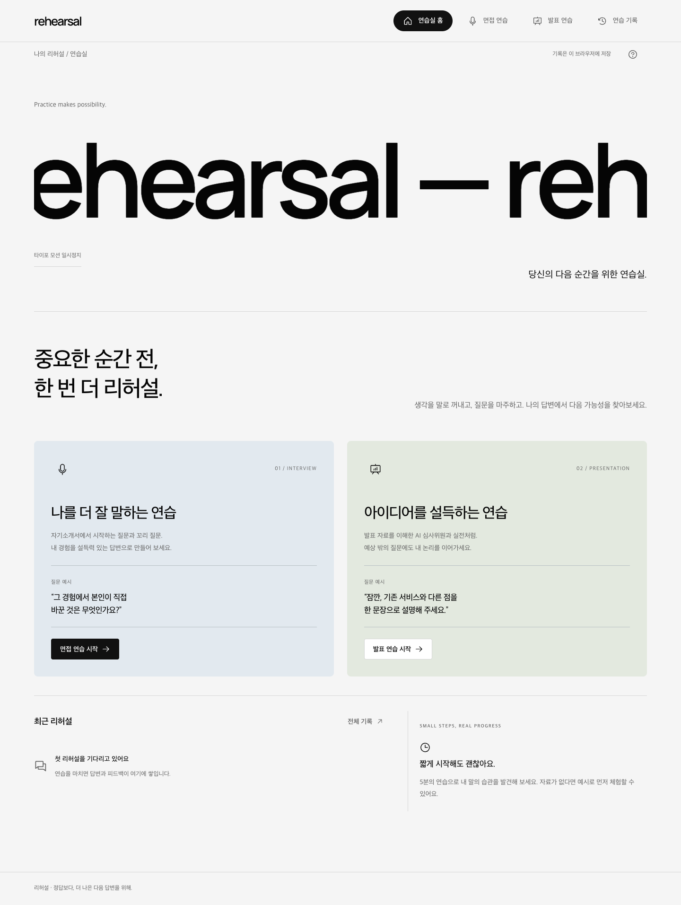
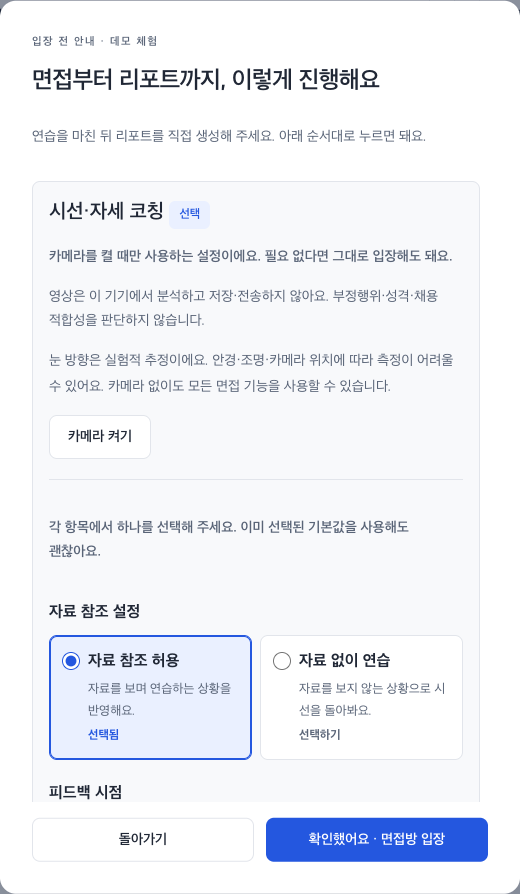
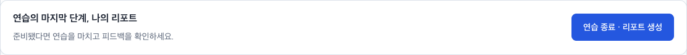
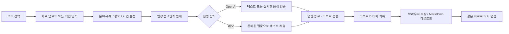
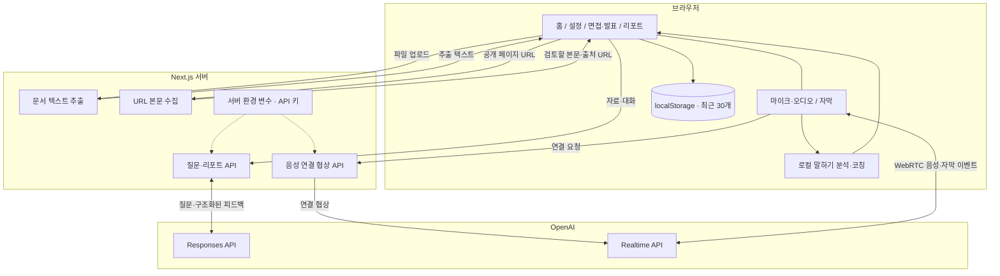
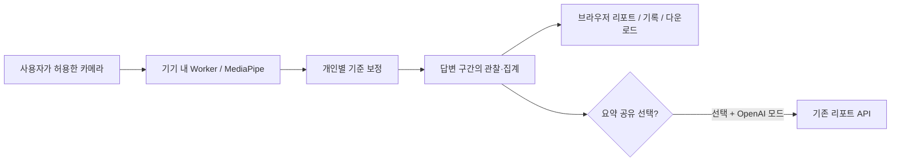

<div align="center">

# Rehearsal · 리허설

### 중요한 순간 전, 한 번 더 리허설.

내 자기소개서로 면접을 준비하고, 내 발표 자료로 반박 질문에 답하는 한국어 AI 연습실.


[프로젝트 소개](#프로젝트-소개) · [화면 미리보기](#화면-미리보기) · [사용 흐름](#사용-흐름) · [시스템 구조](#시스템-구조) · [로컬 실행](#로컬-실행) · [검증 상태](#검증-상태)

</div>



## 프로젝트 소개

혼자 연습할 때는 내 답변의 빈틈을 알아차리기 어렵습니다. 리허설은 제출한 자료와 답변을 바탕으로 질문을 이어가고, 연습을 마치면 실제 발언을 근거로 피드백을 정리합니다. 한 달 동안 개발하는 교내 ICT 경진대회 출품 프로젝트입니다.

| | 면접 연습 | 발표 연습 |
| :--- | :--- | :--- |
| 준비 자료 | 이력서·자기소개서 + 선택한 기업 자료 | 발표 원고·슬라이드 텍스트 |
| 설정 | 지원 분야, 질문 강도, 연습 시간 | 발표 주제, 질문 강도, 연습 시간 |
| 질문 방향 | 공고 요구 역량·기업 가치와 경험을 연결하는 꼬리 질문 | 문제 정의, 차별점, 실현 가능성에 대한 질문·반박 |
| 음성 진행 | 답변이 끝나면 다음 질문 | 발표 중 일정 간격으로 질문 시도, 수동 질문 가능 |
| 연습 결과 | 답변 근거, 개선점, 다음 연습 과제 | 발언 근거, 개선점, 다음 연습 과제 |

> [!NOTE]
> **실제 질문 생성·리포트 생성·실시간 음성의 첫 응답을 확인했습니다.**
> 2026-10-21 기준으로 세 API가 정상 응답했고, 음성 연결 후 첫 질문의 한국어 자막과 오디오 데이터 수신을 확인했습니다. 사람 목소리로 여러 번 주고받는 대화와 발표 중 자동 반박은 추가 검증 대상입니다. [검증 범위 보기](docs/QA.md)

## 화면 미리보기

시작 전에 클릭 순서를 확인하고, 연습 중에는 상단의 리포트 버튼으로 마무리합니다. 아래 화면은 가상 예시 자료를 사용한 데모입니다.

<details open>
<summary><strong>입장 전: 연결부터 리포트 저장까지 4단계 안내</strong></summary>

<p align="center">
  
</p>

</details>

**연습 중: 스크롤해도 보이는 리포트 생성 버튼**



답변을 한 번 이상 남기면 버튼이 활성화됩니다. 생성 중에는 진행 상태를 표시하고, 완료되면 리포트 화면으로 이동합니다. 실패하면 답변을 유지하며 같은 자리에서 재시도할 수 있습니다.

## 사용 흐름

자료를 준비한 뒤 텍스트 또는 음성으로 연습하고, 리포트에서 답변을 돌아봅니다.



1. **자료 준비**: 파일을 올리거나 내용을 붙여 넣습니다. 자료가 없으면 **예시 불러오기**로 시작합니다.
2. **연습 설정**: 면접 지원 분야 또는 발표 주제, 질문 강도, 목표 시간을 선택합니다.
3. **입장 안내 확인**: 시작 버튼을 누르면 연결 → 답변 → 리포트 생성 → 저장 순서를 안내합니다. 확인 후 연습방에 입장합니다.
4. **질문에 답하기**: 글로 답하거나 시작 단계에서 **실시간 음성 연결**을 선택합니다.
5. **리포트 확인**: 상단에 고정된 **연습 종료 · 리포트 생성**을 누르면 잘한 점, 개선점, 실제 발언 근거와 다음 과제를 확인합니다.
6. **기록 보관**: 이 브라우저에서 다시 열거나 리포트를 Markdown 파일로 내려받습니다.

<details>
<summary><strong>음성 진행과 발표 반박 질문</strong></summary>

- 음성 연결은 연습 시작 단계에서 선택합니다. 마이크 권한과 localhost 또는 HTTPS 환경이 필요합니다.
- 음성 대화에는 한국어 자막이 표시됩니다. 마이크 일시 정지와 AI 발화 중단을 지원합니다.
- 발표 질문 주기는 부드럽게 **75초**, 보통 **45초**, 압박 **25초**입니다. AI가 이미 말하는 동안에는 새 질문을 건너뜁니다.
- **지금 반박 질문 받기**로 질문을 직접 요청할 수도 있습니다.
- 음성을 종료하면 기록된 자막을 바탕으로 텍스트 연습을 이어갈 수 있습니다.
- 텍스트로 시작한 세션에서는 음성을 새로 연결하지 않습니다. 음성으로 연습하려면 새 연습을 시작합니다.

</details>

### 채용공고·기업 정보 기반 면접

면접 준비 화면에서 이력서·자기소개서와 함께 다음 자료를 선택 입력합니다. 기업 자료 없이도 기존 방식으로 연습할 수 있습니다.

| 입력 | 질문에 반영하는 내용 | 글자 수 제한 |
| :--- | :--- | :--- |
| 채용공고 | 담당 업무, 필수·우대 역량과 지원자의 경험 연결 | 8,000자 |
| 기업 정보 | 제공한 서비스·사업 방향과 경험 연결 | 4,000자 |
| 기업 가치관·인재상 | 가치가 실제 행동과 판단에 드러났는지 확인 | 4,000자 |

예를 들어 공고에서 사용자 경험 개선을 강조하면, 이력서의 사용자 인터뷰 경험을 바탕으로 개선 효과를 확인하는 질문을 만듭니다. 답변 뒤에는 관련 역량·가치에 대한 꼬리 질문을 이어갑니다.

텍스트 질문의 **질문에 사용한 자료**를 펼치면 공고·기업 자료·이력서의 원문 인용을 볼 수 있습니다. 서버는 입력 자료에 실제 존재하는 인용만 남깁니다. 이 출처는 리포트의 대화 기록과 Markdown 내보내기에도 포함됩니다. 음성 모드에도 같은 자료를 전달하고, 참고한 근거를 말로 밝히도록 지시합니다. 음성 자막에는 별도 출처 카드를 생성하지 않습니다.

기본 입력 방식은 **URL 자동 수집**입니다. 공식 채용·기업 페이지 URL을 넣고 **URL 가져오기**를 누르면 본문을 가져오며, 확인·수정한 내용을 질문에 사용합니다. 수집에 실패해도 입력란이 자동으로 열리지 않습니다. **수동 입력** 버튼을 누르면 직접 붙여 넣을 수 있는 입력란이 나타납니다. 기존 내용은 실패해도 유지됩니다.

로그인·봇 차단·자바스크립트 전용 페이지는 수집되지 않을 수 있습니다. 공개 HTML·텍스트만 읽으며, 최대 12초·2 MB·3회 페이지 이동으로 제한합니다. 내부 네트워크 주소는 차단합니다. 수집 URL은 기록과 내보내기에 남지만, 내용의 최신성이나 사실 여부를 보증하지는 않습니다. **예시 불러오기**의 기업·채용 자료는 가상 예시이며, 데모 질문은 입력 원문을 준비된 질문 틀에 넣는 방식입니다.

### 말하기 톤 분석과 코칭

연습 화면에서 **말하기 분석 시작**을 누르고 말한 뒤 **분석 마치기**를 선택하면, 브라우저에서 측정한 음량·높낮이·쉼을 바탕으로 구체적인 연습 팁을 보여 줍니다. 데모에서도 사용할 수 있고, 실시간 음성 연결 시에는 같은 마이크로 자동 측정합니다. 일시 정지와 AI 발화 중에는 측정을 건너뜁니다.

- **측정값**: 말소리 추정 구간, 1.5초 이상 쉼, 음량·음높이 범위와 입력 소리 찌그러짐 가능성.
- **자막이 있을 때만**: 발화 구간 기준 글자/분, “음·어·저기·그러니까” 반복 횟수.
- **개선 피드백**: 핵심 단어 강조, 일정한 마이크 거리, 결론 → 행동 → 결과 순서로 말하기 등.
- **기록**: 가장 최근 측정의 수치와 피드백을 리포트·브라우저 기록·Markdown 내보내기에 포함합니다.

원본 녹음은 저장하지 않습니다. 분석은 신호 기반 추정이므로 주변 소음·기기·목소리에 따라 오차가 있습니다. 측정이 부족하면 수치를 평가하지 않고 다시 측정하도록 안내합니다. 성격·감정·합격 가능성을 판정하지 않습니다. 실시간 음성 모드의 오디오는 대화를 위해 OpenAI에 전송되며, AI 리포트에는 측정 수치를 전달합니다.

## 주요 기능

두 모드는 같은 디자인 체계와 기록 기능을 공유하며, 실제 API와 데모를 구분합니다.

| 기능 | 동작 |
| :--- | :--- |
| 자료 기반 질문 | 이력서·공고·기업 가치와 이전 답변을 연결해 한 번에 질문 하나 생성 |
| URL 자료 수집 | 공개 채용·기업 페이지 본문 추출, 실패 시 선택적 수동 입력 |
| 말하기 분석 | 마이크 신호 기반 톤·쉼 피드백, 기록과 내보내기 |
| 실시간 음성 | WebRTC로 음성 송수신, 자막 표시, AI 말 멈추기 |
| 입장 안내·리포트 생성 | 입장 전 순서 안내, 상단 고정 버튼, 생성 상태·재시도 안내 |
| 근거 중심 피드백 | 사용자 답변에 실제로 존재하는 인용문만 보고서 근거에 포함 |
| 연습 기록 | 현재 브라우저에 최근 30개 보관, 모드별 조회·삭제 |
| 파일 내보내기 | 피드백과 전체 대화를 Markdown으로 다운로드 |
| 데모 체험 | API 키 없이 준비된 질문 틀로 체험, 실제 AI 분석이 아님을 표시 |
| 접근성 고려 | 키보드 포커스, 모션 감소 설정, 오류 안내와 자막 |

### 지원 자료

업로드한 문서는 서버에서 텍스트로 추출합니다. 추출한 내용은 연습 전에 직접 수정할 수 있습니다.

| 형식 | 처리 방식 | 제한 |
| :--- | :--- | :--- |
| PDF | 문서의 텍스트 추출 | 80쪽 이하 |
| DOCX | 본문 텍스트 추출 | 표·서식의 시각적 분석 제외 |
| PPTX | 슬라이드 순서대로 텍스트 추출 | 슬라이드 이미지 분석 제외 |
| TXT | UTF-8 텍스트 읽기 | UTF-8 인코딩 |

모든 파일은 **최대 10 MiB**, 추출·입력 텍스트는 **최대 30,000자**입니다. 스캔 문서의 이미지 속 글자를 읽는 OCR은 지원하지 않으므로 텍스트를 직접 붙여 넣어 주세요.

## 시스템 구조

화면과 API를 하나의 Next.js 앱에서 실행합니다. 비밀 API 키는 서버에서 사용하며, 실시간 음성은 연결 협상 후 브라우저와 OpenAI 사이에서 송수신합니다.



### 기술 스택

| 영역 | 기술 | 역할 |
| :--- | :--- | :--- |
| 앱 | Next.js 16, React 19, TypeScript | 화면과 서버 API, 타입 검사 |
| UI | Tailwind CSS 4, 공통 CSS 토큰 | 색상·타이포·간격과 반응형 레이아웃 |
| 인터랙션 | Motion, Radix UI, Phosphor Icons | 숫자·전환 프리미티브, 대화상자, 아이콘 |
| AI | OpenAI SDK, WebRTC | 질문·리포트 생성, 실시간 음성 |
| 검증·요청 | Zod, ky | 입력·응답 형식 검사, HTTP 요청 |
| URL 처리 | Cheerio, ipaddr.js, Node HTTP | 본문 추출, 공개 IP 검증·DNS 고정 |
| 말하기 분석 | Web Audio API | 브라우저 내 음량·음높이·쉼 측정 |
| 문서 처리 | pdf-parse, mammoth, fflate | PDF·DOCX·PPTX 텍스트 추출 |
| 개발·검증 | pnpm, Biome, Playwright | 의존성 관리, 코드 검사, 브라우저 검증 |

### 폴더 구조

화면은 `components`, 음성 연결은 `hooks`, 서버 처리는 `app/api`와 `lib/server`에서 찾을 수 있습니다.

```text
rehearsal-studio/
├── src/
│   ├── app/
│   │   ├── api/              # 자료 추출·질문·리포트·음성 API
│   │   ├── page.tsx          # 앱 진입점
│   │   ├── layout.tsx        # 한국어 설정·메타데이터
│   │   └── globals.css       # 공통 디자인 토큰
│   ├── components/
│   │   ├── studio-app.tsx    # 화면 전환과 기록 관리
│   │   ├── home.tsx          # 모드 선택
│   │   ├── setup.tsx         # 자료·연습 설정
│   │   ├── session-guide.tsx # 입장 전 4단계 안내
│   │   ├── session.tsx       # 면접·발표 진행과 리포트 생성
│   │   ├── report.tsx        # 피드백·대화 보기
│   │   └── history.tsx       # 기록 조회·삭제
│   ├── hooks/                # 실시간 음성 연결·자막·리소스 정리
│   └── lib/                  # 공통 타입·요청·저장·서버 로직
├── docs/                     # 디자인·출처·검증 기록
├── .env.example              # 환경 변수 이름과 기본 모델
├── DESIGN.md                 # 공통 디자인 기준
└── THIRD-PARTY.md            # 오픈소스 고지
```

## 로컬 실행

**Node.js 22 이상과 pnpm**을 준비합니다. 키 없이 데모를 먼저 확인할 수 있습니다.

### 1. 저장소 받기

저장소를 복제하고 의존성을 설치합니다.

```sh
git clone https://github.com/luckyandy7/rehearsal-studio.git
cd rehearsal-studio
pnpm install --frozen-lockfile
```

### 2. 환경 변수 설정

예시 파일을 복사합니다. 실제 AI를 사용하려면 `.env.local`의 `OPENAI_API_KEY`에 본인의 키를 입력합니다.

```sh
cp .env.example .env.local
```

| 환경 변수 | 용도 | 기본값 |
| :--- | :--- | :--- |
| `OPENAI_API_KEY` | 실제 AI 사용에 필요한 서버 전용 키 | 비어 있음, 데모 이용 가능 |
| `OPENAI_MODEL` | 질문 생성 모델 | `gpt-6-luna` |
| `OPENAI_REPORT_MODEL` | 리포트 생성 모델 | `gpt-6.1-sol` |
| `OPENAI_REALTIME_MODEL` | 실시간 음성 모델 | `gpt-realtime-2.1-mini` |
| `NEXT_PUBLIC_ENABLE_REACT_DEVTOOLS` | 개발용 React Grab·Scan 활성화 | `0` |

`.env.local`은 Git에서 제외합니다. 키 이름에 `NEXT_PUBLIC_`을 붙이지 마세요. OpenAI 모드는 API 사용 요금이 발생하며, 키 설정 후에는 서버를 다시 시작합니다.

### 3. 개발 서버 실행

서버를 실행하고 **[로컬 연습실](http://localhost:3000)**을 엽니다.

```sh
pnpm dev
```

키 없이 확인하려면 **면접 또는 발표 → 예시 불러오기 → 데모 체험 → 데모 연습 시작 → 안내 확인 후 입장**을 선택합니다.

<details>
<summary><strong>검사·프로덕션 실행 명령</strong></summary>

| 명령 | 용도 |
| :--- | :--- |
| `pnpm typecheck` | TypeScript 타입 검사 |
| `pnpm lint` | Biome 코드 검사 |
| `pnpm build` | 프로덕션 빌드 |
| `pnpm start` | 빌드한 앱 실행 |
| `pnpm doctor` | React 진단 도구 실행 |

개발·빌드 명령은 Webpack을 사용합니다. 초기 개발 환경에서 Turbopack과 외부 codegraph 경로가 충돌해 이 실행 경로로 검증했습니다.

React Grab·React Scan은 개발 환경에서 `NEXT_PUBLIC_ENABLE_REACT_DEVTOOLS=1`인 경우에만 활성화합니다.

</details>

## 검증 상태

아래는 **2026-10-21까지 확인한 결과**입니다. 구현 여부와 실제 API 성공 여부를 구분해 기록합니다.

| 항목 | 결과 |
| :--- | :--- |
| 타입 검사·프로덕션 빌드 | 통과 |
| Biome 검사 | 오류 0, 경고 16 |
| 면접·발표 데모 전체 흐름 | Chrome에서 확인 |
| TXT·PDF·DOCX·PPTX 추출 | 합성 예시 문서로 확인 |
| 기록 복원·삭제·Markdown 다운로드 | Chrome에서 확인 |
| 기업 자료 입력·질문 출처·기록 복원·다시 연습 | Chrome 데모에서 확인 |
| 질문·리포트·음성의 기업 자료 전달 | 모의 OpenAI 응답으로 API 경계 확인 |
| URL 수집·실패 후 수동 입력 | 공개 페이지 실제 수집 및 Chrome 전환 확인 |
| 말하기 측정·코칭·기록 | 합성 음성 입력과 무음 입력으로 Chrome에서 확인 |
| 입장 안내·고정 리포트 버튼 | Chrome 1440/390/320 px, 취소·재입장·생성 실패 후 재시도 확인 |
| 실제 AI 질문·리포트 | 두 API 모두 HTTP 200, 한국어 질문·구조화된 피드백 확인 |
| 실제 음성 첫 응답 | 연결 HTTP 200, 응답 completed, 한국어 자막·오디오 패킷 수신 확인 |
| 사람 음성 다회차 대화·발표 중 자동 반박 | 추가 검증 필요 |

오류가 나면 대화 기록을 화면에 유지하며, 실제 AI 실패를 데모 답변으로 대체하지 않습니다. 상세한 재현 범위와 미검증 항목은 [QA 문서](docs/QA.md)에 있습니다.

## 실행 중 막힐 때

화면의 안내를 먼저 확인하고, 해당 항목에 따라 진행하세요.

| 상황 | 확인할 내용 |
| :--- | :--- |
| 키가 설정되지 않았다고 나와요 | 저장소 루트 `.env.local`의 `OPENAI_API_KEY`를 입력하고 서버를 재시작하세요. 키는 채팅이나 GitHub에 올리지 마세요. |
| API 한도·잔액 오류가 나와요 | 키가 속한 조직의 [API 결제 상태](https://platform.openai.com/settings/organization/billing)를 확인하세요. 충전 반영을 기다린 뒤 재시도하세요. |
| URL을 가져오지 못해요 | 로그인·차단·동적 페이지일 수 있습니다. **수동 입력**을 눌러 필요한 내용을 붙여 넣으세요. |
| 리포트 버튼을 누를 수 없어요 | 답변을 입력하거나 말한 내용이 **나의 답변** 자막으로 표시됐는지 확인하세요. 다른 요청이 처리 중이면 기다려 주세요. |
| 음성 연결이 안 돼요 | 브라우저 마이크 권한과 HTTPS 또는 localhost 접속 여부를 확인하세요. |
| 말하기 분석이 부족하다고 나와요 | 조용한 곳에서 마이크 거리를 유지하고 10초 이상 말해 보세요. |

## 데이터와 사용 범위

현재 버전은 **로컬 단일 사용자 연습용**입니다. 공개 GitHub 저장소와 서비스의 공개 배포는 별개이며, 서버는 기본적으로 localhost에서 실행합니다.

- **OpenAI 전송**: 실제 AI 모드에서 자료·답변을 전송합니다. 음성 모드에서는 마이크 음성도 전송합니다.
- **URL 수집**: 입력한 공개 URL을 서버가 방문합니다. 가져온 본문은 사용자가 검토한 뒤 연습 자료로 사용합니다.
- **말하기 분석**: 원본 녹음 대신 측정 수치만 기록합니다. 텍스트·데모 모드의 독립 마이크 분석은 브라우저 안에서 처리합니다.
- **서버 저장**: 업로드 원본이나 녹음 파일을 별도로 디스크에 저장하지 않습니다.
- **브라우저 저장**: 완료한 자료·대화·리포트를 현재 브라우저에 최근 30개까지 보관합니다. 브라우저 데이터를 지우면 기록도 사라집니다.
- **공용 PC 사용**: 연습 후 기록을 삭제하고 보관할 리포트는 내려받아 주세요.
- **공개 배포 전 작업**: 사용자 인증과 사용자별 사용량·과금 제한을 추가해야 합니다.

피드백은 연습을 돕는 참고 자료입니다. 채용 결과나 실제 심사 점수를 예측하지 않습니다.

## 관련 문서

디자인 기준, 구현 기록과 오픈소스 출처를 다음 문서에서 확인할 수 있습니다.

| 문서 | 내용 |
| :--- | :--- |
| [디자인 기준](DESIGN.md) | 색상·타이포·간격·접근성·모션 기준 |
| [디자인 도구](docs/DESIGN-TOOLS.md) | 참고한 9개 도구와 역할 |
| [개발 스킬 출처](docs/SKILL-SOURCES.md) | 설치 출처와 무결성 기록 |
| [구현 현황](docs/IMPLEMENTATION-PLAN.md) | 완료 항목과 외부 조건으로 남은 검증 |
| [검증 기록](docs/QA.md) | 실제 확인 결과와 미검증 범위 |
| [서버 구현 출처](src/lib/server/SOURCES.md) | API·문서 처리 참고 자료 |
| [오픈소스 고지](THIRD-PARTY.md) | 참고한 구현과 라이선스 |

외부 도구 원본과 로컬 개발 스킬은 이 저장소에 포함하지 않습니다. 도구 출처와 다운로드 해시는 [소스 목록](.design-tools/sources.lock.json)에 기록합니다. Google Stitch는 사용하지 않습니다.

## 📷 시선·자세 코칭

면접·발표 입장 안내에서 **카메라 켜기 → 기준 자세 보정(10초) → 입장**으로 시작합니다. 선택 기능이며, 권한을 거부하거나 모델을 불러오지 못해도 **카메라 없이 진행**할 수 있습니다.

| 단계 | 동작 |
| --- | --- |
| 준비 | 얼굴이 모두 보이도록 조정하고, 카메라와 안내 문장을 보며 개인별 기준 범위를 보정 |
| 음성 연습 | 사용자 발화 감지 이벤트와 연동해 답변 구간만 측정. AI 발화·휴식·백그라운드 탭 제외 |
| 텍스트 연습 | ‘답변 측정 시작 / 마치기’로 측정 구간 직접 선택. 타이핑 중 움직임도 포함 |
| 리포트 | ‘시선·자세’에서 측정 가능 비율, 얼굴·눈 방향 변화, 상체 이동, 손목과 얼굴 영역 겹침 확인 |
| 저장 | 기존 연습 기록과 Markdown 다운로드에 요약·관찰 구간 포함. 이전 버전 기록도 열람 가능 |

- **실전 모드**는 종료 후 피드백, **코칭 모드**는 연습 중 최근 관찰 안내를 제공합니다. 자료 참조 허용 여부에 맞춰 조언합니다.
- 원본 영상·프레임·얼굴 좌표는 저장하거나 서버에 보내지 않습니다. MediaPipe Face/Pose Landmarker를 Web Worker에서 실행하며, 처리한 프레임은 해제합니다.
- **‘측정 요약을 OpenAI 리포트에도 사용하기’는 기본 해제**입니다. 선택한 실제 OpenAI 모드에서만 집계와 구간 정보를 `/api/report`에 보냅니다. 로컬 리포트는 이 선택 없이도 제공됩니다.
- 얼굴을 안정적으로 측정한 답변 10초 이상, 얼굴 측정 가능 비율 60% 이상일 때 충분한 측정으로 표시합니다. 짧은 변화는 관찰 구간에서 제외하고, 최대 30분·80개 구간으로 제한합니다.
- 눈 방향은 **실험적 좌표 추정**입니다. 정확한 화면 주시점, 글 읽기, 부정행위, 감정·성격·자신감·채용 적합성을 판단하지 않습니다. 안경·가림·조명·카메라 위치에 따라 오차가 있습니다. 손목 겹침도 실제 가림을 확정하지 않습니다.
- 시간 표시는 **연습방 입장 이후** 기준입니다. 원본 영상을 보관하지 않아 구간 재생은 제공하지 않습니다. 자막이 없거나 미완성인 구간은 질문 연결이 제한됩니다.



**설치 및 검증:** `pnpm dev`와 `pnpm build`는 필요한 모델과 WASM을 자동 준비합니다. 첫 실행에는 모델 다운로드를 위한 네트워크가 필요하며, 이후에는 해시가 일치하는 로컬 캐시를 재사용합니다. 수동 준비는 `pnpm camera:prepare`, 분석 로직 검사는 `node tests/camera-analysis.cjs`입니다. 리포트 API 동의 검사는 `node tests/camera-report-api.cjs`로 실행합니다. 개발 서버를 켠 뒤 `node tests/camera-browser.cjs`로 Chrome 회귀 검사를 실행할 수 있습니다. 추가로 `node tests/camera-realtime.cjs`는 가상 음성 이벤트와 재연결, `node tests/camera-failures.cjs`는 모델 실패·얼굴 미검출·포커스 복원을 검사합니다. 브라우저 검사는 모델 결과를 모의해 UI·동의·저장·자원 해제를 검증하며 모델 정확도를 검증하지 않습니다. `TEST_BASE_URL`로 실행 중인 서버 주소를 바꿀 수 있습니다.
